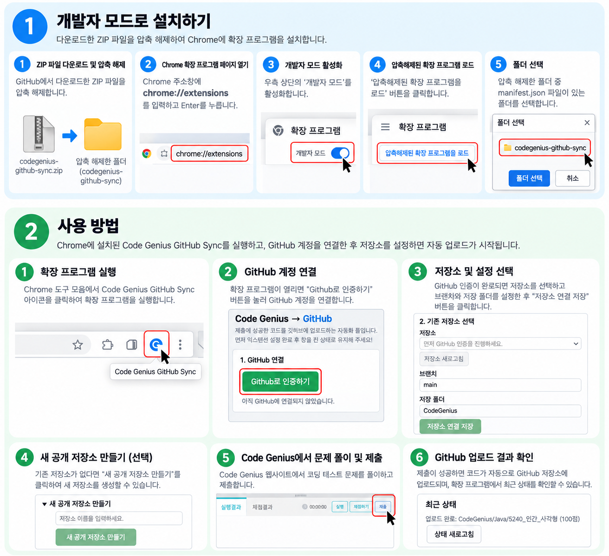

# Code Genius GitHub Sync

**Code Genius에서 제출한 코딩 테스트 코드를 GitHub에 자동으로 저장하는 Chrome 확장 프로그램**

Code Genius GitHub Sync는 Code Genius에서 제출에 성공한 코드를 사용자가 선택한 GitHub 저장소에 자동으로 업로드하는 Chrome 확장 프로그램입니다.

Java와 Python 코드를 언어별·문제별로 정리하여 저장하고, 문제 풀이 기록을 GitHub에서 체계적으로 관리할 수 있도록 도와줍니다.

## 주요 기능

- **자동 코드 업로드**: Code Genius에서 제출 성공한 코드를 감지하여 GitHub에 업로드합니다.
- **언어별 코드 관리**: Java와 Python 코드를 구분하여 저장합니다.
- **문제별 파일 정리**: 문제 번호와 제목을 기준으로 코드를 정리합니다.
- **README 생성**: 문제별 README를 생성하여 풀이 기록을 관리합니다.
- **GitHub 계정 연동**: GitHub OAuth를 통해 사용자 계정을 인증합니다.
- **저장소 관리**: 기존 GitHub 저장소를 연결하거나 `CodingTest` 저장소를 생성할 수 있습니다.
- **공개·비공개 저장소 지원**: 사용자가 선택한 저장소에 코드를 업로드합니다.

## 동작 방식

```text
┌──────────────────────────────┐
│           Code Genius        │
│       문제 풀이 및 제출       │
└──────────────┬───────────────┘
               │ 제출 성공 감지
               ▼
┌──────────────────────────────┐
│    Chrome Extension          │
│  문제 정보 및 제출 코드 처리  │
└──────────────┬───────────────┘
               │
               ▼
┌──────────────────────────────┐
│       GitHub OAuth App       │
│        사용자 계정 인증       │
└──────────────┬───────────────┘
               │ OAuth 인증 중계
               ▼
┌──────────────────────────────┐
│     Cloudflare Worker        │
│   OAuth 인증 흐름 및 결과 전달│
└──────────────┬───────────────┘
               │
               ▼
┌──────────────────────────────┐
│          GitHub API          │
│ 저장소 조회 · 생성 · 코드 업로드│
└──────────────────────────────┘
```

확장 프로그램은 Code Genius에서 제출 정보를 확인하고, GitHub API를 이용해 사용자가 선택한 저장소에 코드를 업로드합니다. GitHub OAuth 인증 과정은 Cloudflare Worker를 통해 처리합니다.

## 기술 스택

| 구분 | 기술 |
|---|---|
| Extension | Chrome Extension API |
| Authentication | GitHub OAuth App |
| Backend | Cloudflare Workers |
| Temporary Storage | Cloudflare Workers KV |
| Code Repository | GitHub REST API |
| Language | JavaScript |

## 설치 방법

### Chrome 웹 스토어

Chrome 웹 스토어에 게시된 경우 스토어 페이지에서 확장 프로그램을 설치할 수 있습니다.

> 스토어 등록 및 공개 상태에 따라 설치 가능 여부가 달라질 수 있습니다.



### 개발자 모드로 설치

1. ZIP 파일을 다운로드 후 압축을 해제합니다.
2. Chrome 주소창에 `chrome://extensions`를 입력합니다.
3. 오른쪽 위의 **개발자 모드**를 활성화합니다.
4. **압축해제된 확장 프로그램을 로드**를 클릭합니다.
5. `manifest.json` 파일이 있는 폴더를 선택합니다.

## 사용 방법

1. Chrome에서 Code Genius GitHub Sync를 실행합니다.
2. GitHub 계정 인증 버튼을 눌러 GitHub 계정을 연결합니다.
3. 기존 저장소를 선택하거나 새 저장소를 생성합니다.
4. Code Genius에서 코딩 테스트 문제를 풀이합니다.
5. 제출에 성공하면 코드가 연결된 GitHub 저장소에 업로드됩니다.
6. GitHub에서 문제별 코드와 README를 확인합니다.

## 권한 안내

확장 프로그램은 자동 코드 저장 기능을 제공하기 위해 다음 권한을 사용합니다.

| 권한 | 사용 목적 |
|---|---|
| `scripting` | Code Genius 페이지에서 문제 제목 등 필요한 정보 확인 |
| `storage` | 인증 정보, 사용자 설정 및 제출 처리 상태 저장 |
| `tabs` | GitHub OAuth 인증 페이지 열기 |
| Host permissions | Code Genius 페이지 접근, GitHub API 통신 및 Cloudflare Worker와의 OAuth 통신 |

실제 배포 버전의 권한 구성은 `manifest.json`을 기준으로 확인할 수 있습니다.

## 보안 및 개인정보 처리

- GitHub 인증은 OAuth를 통해 진행됩니다.
- 인증 정보와 사용자 설정은 브라우저의 확장 프로그램 로컬 저장소에 저장됩니다.
- OAuth 인증 흐름에는 Cloudflare Worker와 Workers KV가 사용됩니다.
- 제출 코드는 사용자가 인증하고 선택한 GitHub 저장소로 업로드됩니다.
- 공개 저장소에 업로드한 코드는 다른 사람이 열람할 수 있습니다.

개인정보 처리에 관한 자세한 내용은 [개인정보 처리방침](./PRIVACY_POLICY.md)을 참고하세요.

## 개발 및 배포

프로젝트의 최신 소스 코드와 변경 사항은 GitHub 저장소에서 확인할 수 있습니다.

- Repository: https://github.com/swkooo/Code-Genius-GitHub-Sync
